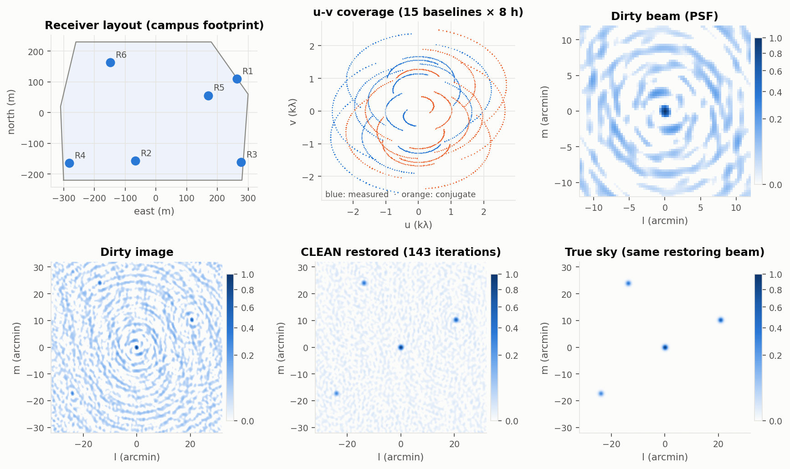
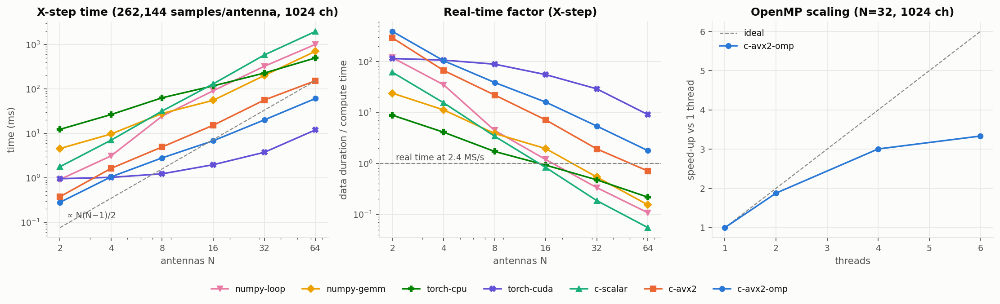
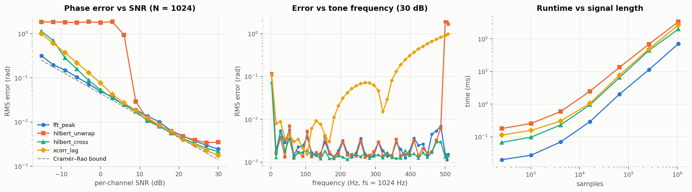
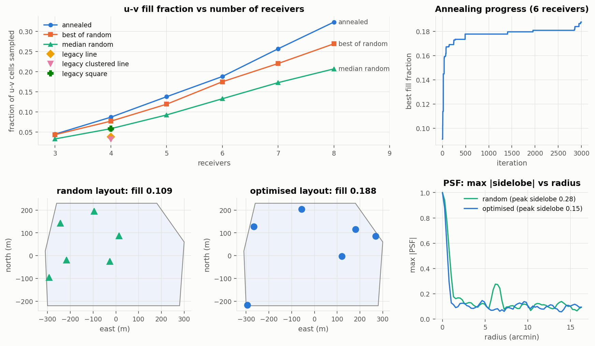
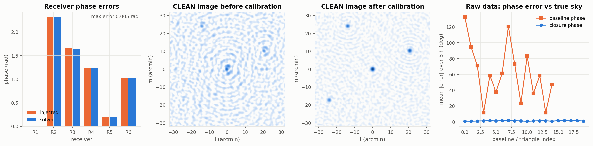

# radiotel: a campus radio interferometer in software

[](https://github.com/alireza-astane/Radio_Telescope_Signal_Processing/actions/workflows/ci.yml)

This project simulates, correlates and images the data of a radio telescope built from several small
receivers spread across a university campus. It covers the whole chain:
**raw receiver voltages → real-time FX correlator (C/AVX2/OpenMP, NumPy, PyTorch) → calibration →
Earth-rotation synthesis imaging → receiver-layout optimisation.**



## Background

It started as my bachelor project at Sharif University of Technology, supervised by Dr. Reza
Rezaee. The group was building radio receivers to place at different spots on campus. My job was to
handle their data streams and compute the **phase differences between every pair of receivers**,
a workload that grows as N(N−1)/2 as receivers are added. The 2024 prototypes (TCP streaming in C,
AVX experiments, phase-estimator notebooks) are preserved in [`legacy/`](legacy/) with notes on what
each did and where it went wrong.

This edition rebuilds that work into a tested, benchmarked package and carries it through to what
the phase differences are *for*: making an image of the sky.

## Highlights

| | |
|---|---|
| **FX correlator, 7 back ends** | NumPy (loop and GEMM), PyTorch (CPU and CUDA), and hand-written C: scalar, **cache-blocked AVX2+FMA**, and AVX2+OpenMP. All agree to float32 precision. |
| **Performance** | On a 6-core laptop CPU (i5-10500H), the cache-blocked AVX2+OpenMP X-step reaches **69 GFLOP/s**: **8.6×** scalar C, **11.6×** NumPy's BLAS formulation at 64 antennas, and **1.8× real time** for 64 receivers (2016 baselines) at 2.4 MS/s. On a Colab Tesla T4 the PyTorch back end reaches **352 GFLOP/s, 9× real time** at 64 receivers (5× the CPU kernel). Small arrays stay faster on the CPU. |
| **Real-time streaming** | `rx_sim` emulates N receivers sending 8-bit I/Q frames over TCP. `corrd` aligns frames by sequence number in per-receiver ring buffers, applies back-pressure instead of dropping data, and correlates live. It sustains **12.4 MS/s per receiver for 8 receivers (5× real time)** and 4.9 MS/s for 16, with zero overruns in paced 2.4 MS/s runs. Its output matches the offline correlator to about 1e-7. |
| **Physically faithful simulation** | Sources are complex Gaussian noise with exact fractional geometric delays from campus geometry and Earth rotation. CLEAN recovers the fluxes of a four-source sky to within about 5 % starting from simulated voltages. |
| **Calibration** | StEFCal solves per-receiver complex gains from a calibrator scan (1 rad errors → 0.005 rad). Closure phases are shown to be gain-invariant. |
| **Array design** | Simulated annealing places receivers inside the campus footprint to maximise u-v coverage. For 8 receivers, annealing reaches 0.32 u-v fill against 0.27 for the best of 200 random layouts. The original hand-made 4-receiver square layout reached 0.058; the optimised one reaches 0.087. |
| **Reproducible** | 55 tests, CI, every figure produced by a script, every number in the report generated from committed CSVs. |

## Results at a glance

<table>
<tr>
<td width="50%"></td>
<td width="50%"></td>
</tr>
<tr>
<td><b>Correlator scaling.</b> X-step cost follows N(N−1)/2. Cache blocking makes the AVX2 kernel scale across cores. The GPU has a ~1 ms launch floor but wins from 8 receivers up (Colab Tesla T4).</td>
<td><b>Phase estimators</b> from the original project, against the Cramér–Rao bound. The legacy Hilbert+unwrap method breaks down at low SNR.</td>
</tr>
<tr>
<td></td>
<td></td>
</tr>
<tr>
<td><b>Layout optimisation</b> on the campus footprint, compared with the original hand-made layouts.</td>
<td><b>Gain calibration</b>: the image before and after StEFCal, and closure phases.</td>
</tr>
</table>

Full tables: [docs/benchmark_tables.md](docs/benchmark_tables.md) · Report:
[report/report.pdf](report/report.pdf)

## Quick start

Requirements: Python ≥ 3.10 with NumPy, SciPy and Matplotlib; GCC with OpenMP on x86-64 (AVX2 is
optional, and there is a scalar fallback); PyTorch is optional.

```bash
pip install -e ".[dev]"      # add [torch] for the PyTorch back ends
make lib                     # builds src/radiotel/correlator/libfxcorr.so + csrc/stream/{rx_sim,corrd}
make test                    # 55 tests
python examples/02_campus_array_imaging.py   # the figure at the top of this page
```

```python
import numpy as np
from radiotel import sky, layout, pipeline, imaging

obs = sky.Observation()                                    # 1420 MHz, 2.4 MHz band, 8 h, 64 channels
pos = layout.anneal_layout(6, obs).positions               # 6 receivers on the campus footprint
vis = pipeline.observe(pos, sky.demo_sky(), obs)           # voltages -> FX correlator, 48 snapshots
uvw, v = vis.flat()
cell = 1 / (4 * abs(uvw[:, :2]).max())
dirty = imaging.dirty_image(uvw, v, 256, cell)
clean = imaging.hogbom_clean(dirty, imaging.dirty_beam(uvw, 256, cell), threshold=0.02)
```

Streaming correlator:

```bash
csrc/stream/corrd --n-ant 8 --port 5000 --nchan 64 --out vis.bin &
csrc/stream/rx_sim --n-ant 8 --port 5000 --frames 2000 --rate 2.4   # 2.4 MS/s per receiver
```

## Repository map

| | |
|---|---|
| [`src/radiotel/`](src/radiotel/) | the Python package: geometry, sky, signals, phase estimators, correlator back ends, pipeline, imaging, calibration, layout |
| [`csrc/`](csrc/) | C X-step kernels, FFT, and the streaming tools ([`csrc/stream/`](csrc/stream/)) |
| [`examples/`](examples/) | four walkthroughs: two-element fringes, campus imaging, layout optimisation, calibration |
| [`benchmarks/`](benchmarks/) | benchmark scripts, committed results, figure and table generation, and a [Colab GPU notebook](benchmarks/gpu_colab.ipynb) |
| [`docs/`](docs/) | [theory](docs/theory.md), [architecture](docs/architecture.md), [benchmark methodology](docs/benchmarks.md), [tables](docs/benchmark_tables.md) |
| [`report/`](report/) | LaTeX technical report (`make report`) |
| [`tests/`](tests/) | pytest suite |
| [`legacy/`](legacy/) | the original 2024 code, unchanged, with a [guide](legacy/README.md) |

## GPU numbers

The CPU benchmarks ran on a laptop (i5-10500H). The `torch-cuda` rows come from a Colab GPU via
[`benchmarks/gpu_colab.ipynb`](benchmarks/gpu_colab.ipynb), which runs the same sweep and writes
`correlator_gpu.csv`. `make figures report` merges that file into the plots, tables and report. GPU
times exclude host↔device copies, and the streaming daemon `corrd` is still CPU-only.

## Limitations

Receivers and correlator share one machine over loopback, so there is no real network and no clock
distribution. Imaging uses nearest-neighbour gridding with no w-term or primary-beam correction, and
the sky contains only point sources. Real receiver data were not available, but
`rx_sim --input` accepts recordings in a simple binary format. See the report for details and
possible extensions (polyphase filter bank, RFI flagging, tensor-core correlation, HI spectral-line
imaging).

## License

MIT, see [LICENSE](LICENSE).
